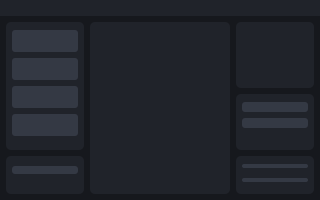

# agent-harness

My agent workspace, so it can be set up the same way on any Windows computer:

- **A Herdr layout for Natsumi**: the GitHub project board, a Claude chat, Actions, sub-agents and plan usage in one window.
- **The usage-bar mod for Claude Code**: model, effort and how much of the plan is left, shown above the prompt. It also feeds the Usage panel in the layout.



## Install

1. Install what's listed under [What you need](#what-you-need).
2. Clone this repo and run the installer from its folder:

   ```powershell
   git clone git@github.com:hanssonfredrik/agent-harness.git C:\Projects\Venueve\agent-harness
   cd C:\Projects\Venueve\agent-harness
   powershell -NoProfile -ExecutionPolicy Bypass -File .\install.ps1
   ```

   If the Natsumi repo is in another folder, say so: `.\install.ps1 -RepoFolder D:/code/MessengerApp`.
   Add `-WhatIf` to see what would be copied without copying anything.

3. Restart Claude Code. It loads usage-bar when it starts.
4. In Herdr, press `ctrl-shift-l` and pick **natsumi**. The **Main layout** button in the top bar goes back.

The installer:

- copies each file to where Herdr and Claude Code read it (the table below),
- fills in this computer's folders, which the repo holds as `{{HERDR_APP_HOME}}` and `{{REPO_FOLDER}}`,
- backs up every file it replaces to `~\.agent-harness-backup\<date-time>\`,
- warns about any tool missing from the PATH,
- never touches run state: panel sizes, agent state and the usage reading.

Running it again after a `git pull` is safe.

## What you need

| Tool | Why |
|---|---|
| [Herdr](https://herdr.dev) app and herdr-core (`herdr-app`, `hc`) | Runs the layout and starts agents in their own tabs |
| Claude Code, signed in with a Claude subscription (Pro, Max or Team) | The chat, and the usage figures. An API key has no plan limits to show |
| GitHub CLI `gh`, signed in on an account with the `project` scope | Board and Actions. Add the scope with `gh auth refresh -s project` |
| Node.js on the PATH | The Sub-agents panel and the board agents' hooks |
| The Natsumi repo cloned at `C:\Projects\Venueve\MessengerApp`, or the folder you pass as `-RepoFolder` | Where agents start, and where Sub-agents looks |

## What's in the repo

| In the repo | Installed to | What it is |
|---|---|---|
| `herdr/layouts/natsumi.json` | `~\.config\herdr-app\layouts\` | The layout: which panel goes where, and at what size |
| `herdr/layouts/natsumi.svg` | same | The preview in Herdr's layout switcher |
| `herdr/mods/issue-board/` | `~\.config\herdr-app\mods\issue-board\` | Every panel. `props.view` in the layout picks one: `bar`, `board`, `actions`, `now`, `subagents`, `usage` |
| `herdr/issue-agent/` | `~\.config\herdr-app\issue-agent\` | Hooks, settings and the extra prompt for agents started from the board |
| `claude-code/usage-bar/` | `~\.claude\skills\usage-bar\` | The Claude Code mod. Its own README says what it reads |

`~\.config\herdr-app` moves with `HERDR_APP_HOME`, and `~\.claude` with `CLAUDE_CONFIG_DIR`, if either is set.
`-HerdrAppHome` and `-ClaudeHome` override both.

## The layout

```
┌ Natsumi · agent chips ───────────── New chat · refresh · Main layout ┐
├ Left ───────────┬ Chat ───────────────────────┬ Right ──────────────┤
│ In progress     │                             │ Agent: did, doing,  │
│ Next            │  the selected agent's       │ proposed next       │
│ Todo            │  Claude session             ├─────────────────────┤
│                 │                             │ Actions             │
├─────────────────┤                             ├─────────────────────┤
│ Sub-agents      │                             │ Usage               │
└─────────────────┴─────────────────────────────┴─────────────────────┘
```

- **Board**: the In Progress, Next and Todo cards of GitHub project 3. Todo cards have **Move to Next**. Next cards have **Plan**, **Run** and **Move to Todo**. Tick several Next cards to start them together in one session.
- **Plan / Run**: start Claude in its own worktree and tab, in plan mode or auto mode. `herdr/issue-agent/prompt.md` tells it when to move the card.
- **Agent**: what the selected agent did, is doing and proposes next, from the last line of its reply.
- **Actions**: the latest 10 workflow runs, with step progress for running ones.
- **Sub-agents**: sub-agents running in any Claude session under the project folder.
- **Usage**: how much of the week and of the Fable weekly limit is left, and when each resets. It reads what usage-bar last saved in `~\.claude\plugins\store\usage-bar_*.json`, so it needs no login of its own. It shows nothing until a Claude Code session with usage-bar has run a prompt.

Drag the borders to resize panels; Herdr remembers sizes per computer in `layouts\.state\`. To use the layout for another project, copy `natsumi.json` and change `owner`, `project`, `repo` and `folder` in its props.

## Keeping computers in step

After changing the layout or a mod on one computer:

```powershell
cd C:\Projects\Venueve\agent-harness
powershell -NoProfile -ExecutionPolicy Bypass -File .\export.ps1
git diff
git commit -am "Describe the change"
git push
```

`export.ps1` copies the live files back into the repo and turns this computer's folders back into placeholders. It doesn't delete anything: if you removed a file, `git rm` it here too.

On the other computer: `git pull`, then run `install.ps1` again.

## Left out on purpose

- `gpui-kit.d.ts` in the mod and `.claude-plugin/types/` in usage-bar: editor typings the apps provide. The installer copies the mod's from Herdr's own `mods\agents\`.
- `layouts\.state\`, `issue-agent\state\` and the usage-bar store: run state that belongs to each computer.

## If something is wrong

| You see | Check |
|---|---|
| Usage says "No reading yet" | Restart Claude Code and send a prompt. Then look for `snapshot` in `~\.claude\plugins\store\usage-bar_*.json` |
| Fable is missing from Usage | `fableSource` in that same file says why (see `claude-code/usage-bar/README.md`) |
| "Sub-agents can't be read" | `node` isn't on the PATH Herdr was started with. Fix it and restart Herdr |
| The board says gh is not signed in or has no access | `gh auth status`: the active account needs the `project` scope |
| Herdr shows a layout error | `herdr-app status` lists it. `herdr-app check ~/.config/herdr-app/mods/issue-board` checks the mod |
| A panel keeps an old size after a layout change | `herdr-app do layout.resize '{"id":"<panel id>","px":196}'` |
